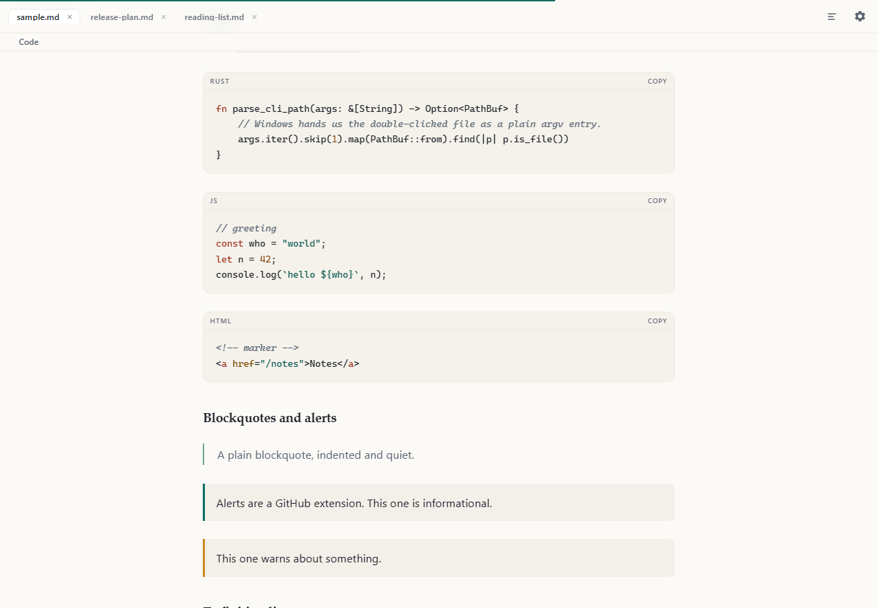
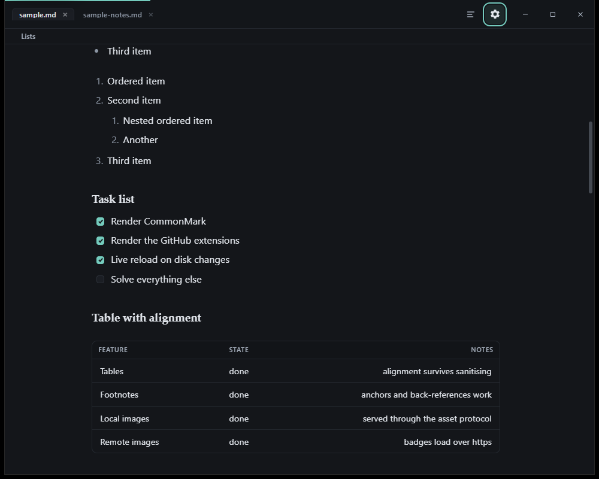
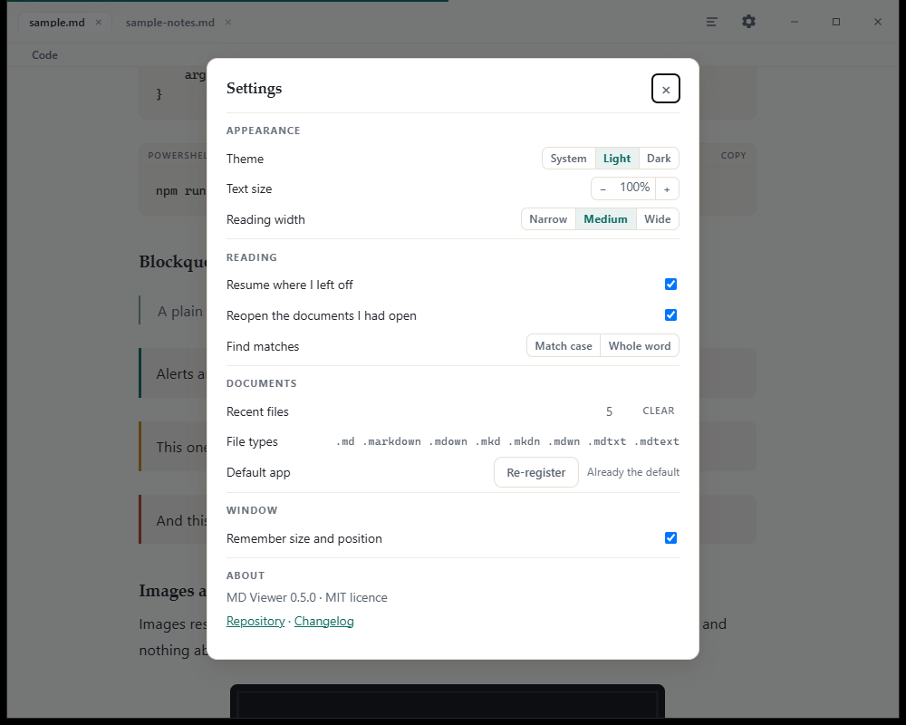

# MD Viewer

[](https://github.com/n4od/md-viewer/actions/workflows/ci.yml)
[](https://github.com/n4od/md-viewer/releases/latest)
[](https://github.com/n4od/md-viewer/releases)
[](LICENSE)
[](#requirements)

**A small, fast desktop reader for Markdown files.** Double-click a `.md` file in
Windows Explorer and it opens, rendered — no browser, no editor chrome, no white
flash before the text appears.



<p align="center"><em>Three documents open as tabs; code is highlighted in Rust before it reaches the webview.</em></p>

## Install

**[Download the latest release](https://github.com/n4od/md-viewer/releases/latest)**

| | File | What it does |
| :-- | :-- | :-- |
| **Installer** (recommended) | `MD.Viewer_<version>_x64-setup.exe` | Installs per user, registers the `.md` handler (and offers `.txt`), and pulls in the WebView2 runtime if the machine lacks it. |
| **Portable** | `MD.Viewer_<version>_x64-portable.exe` | The same build as a single file. Run it from anywhere; nothing to install. Use *Set as default* in Settings, or `--register-default`, when you want it to claim the file types. |

Both are built from the tagged source, and each release ships a
`SHA256SUMS-<version>.txt`. The binaries are **not code-signed yet**, so Windows
SmartScreen may warn on the first run.

For scripted or headless setups, `mdviewer.exe --register-default` writes the per-user
association and exits with 0 or 1, with no UI. Maintenance scripts live in
[`scripts/`](scripts) and are documented in
[docs/build-and-package.md](docs/build-and-package.md).

## What it does

- **Opens Markdown the way Windows expects.** Double-click, drag & drop, *Open with*,
  a second double-click while it is running (the file opens as a new tab in the
  existing window), or `Ctrl+O`.
- **Markdown files look like documents.** The `.md` type gets a page icon of its own in
  Explorer, not a copy of the app tile, and the "Open with" row keeps the app icon
  because that row represents the app.
- **Reading first.** Progress bar, outline drawer, find (match case / whole word),
  per-document reading position, a pinned section title, and an image lightbox. No
  editing controls, because it is a viewer.
- **Renders GitHub-flavoured Markdown:** tables, task lists, alerts, footnotes,
  definition lists, autolinks — sanitised through an allow-list before it reaches the
  page.
- **Syntax highlighting without a highlighter bundle.** Fenced code is tokenised in
  Rust on the render path for the languages notes actually use; unknown languages are
  left alone.
- **Several documents, one window.** Tabs, each with its own scroll position, find
  query and document. The strip appears once a second document is open.
- **Follows the file on disk.** The open document is watched; edit it in another editor
  and the view updates, keeping your place.
- **Yours to adjust.** System/light/dark theme, text size, reading width, reading
  position, session restore, find defaults and remembered window geometry, all in one
  settings dialog.



## Keyboard

| Key | Action |
| :-- | :-- |
| `Ctrl+O` | Open a file |
| `Ctrl+F` | Find; `Enter` / `Shift+Enter` step through matches, `Esc` closes |
| `Ctrl+B` | Contents drawer |
| `Ctrl+Tab` / `Ctrl+Shift+Tab` | Next / previous document (wraps) |
| `Ctrl+W` | Close the document you are reading |
| `Ctrl+R` / `F5` | Reload from disk |
| `Ctrl+Shift+L` | Cycle *system → light → dark* |
| `Ctrl` `+` / `-` / `0` | Text size up / down / reset |
| `Ctrl` + wheel | Text size, the same scale as above |
| `J` / `K` | Scroll a page down / up |
| `Alt+C` / `Alt+W` | Find: match case / whole word |
| `Esc` | Close the find bar, drawer, lightbox or settings |

Inside the tab strip: `←` `→` move between tabs, `Home` / `End` jump to the first and
last, and a middle-click closes the tab under the pointer.



## Requirements

- **Windows 10 or Windows 11**, x64.
- **WebView2 runtime** — preinstalled on Windows 11 and most Windows 10 machines; the
  installer fetches it when it is missing. A portable copy cannot install it, so a
  clean image without the runtime needs the installer first.
- Nothing else: no .NET, no Node, no browser.

## Deliberate limitations

A viewer, by design: **read-only**, **no printing or PDF export**, **no telemetry or
account**, **no network requests at start-up**, **no auto-update** and **no plugin
system**. Multiple windows are also a non-goal — a window is a whole WebView2 process
tree, so tabs carry several documents at flat cost.

Each of these is argued rather than assumed, together with the things that *are*
missing for smaller reasons, in [docs/limitations.md](docs/limitations.md).

## Documentation

| Document | Covers |
| :-- | :-- |
| [docs/architecture.md](docs/architecture.md) | Project layout, the Rust render path and IPC surface, and the three-file frontend. |
| [docs/file-association.md](docs/file-association.md) | How the `.md` association, the ProgIds, the document icon and "Open with" are wired. |
| [docs/build-and-package.md](docs/build-and-package.md) | Debug and release builds, the NSIS installer, registration scripts, the verification checklist and troubleshooting. |
| [docs/performance.md](docs/performance.md) | What the numbers mean, and where the `<100 ms` / `<30 MB` targets came from. |
| [docs/limitations.md](docs/limitations.md) | What the app deliberately does not do, and why. |
| [PERFORMANCE.md](PERFORMANCE.md) | The latest measurement, regenerated by `scripts/measure.ps1`. |
| [ROADMAP.md](ROADMAP.md) | What is planned, what was rejected, and how a new idea gets considered. |
| [CHANGELOG.md](CHANGELOG.md) | Release history. |
| [AGENTS.md](AGENTS.md) | The maintenance contract: architecture notes, invariants and verification habits (written for coding agents, useful to anyone changing the internals). |

## Development

Most of the project can be worked on without Windows, Rust or the Tauri CLI.

**Frontend and docs** — Node only, and no install step:

```bash
node scripts/dev-server.js
# http://127.0.0.1:8123/preview/harness.html   the app, with a fake Tauri bridge
# http://127.0.0.1:8123/preview/tests.html    72 behavioural checks
```

**Rust renderer and tests** — any OS with Rust (on Linux this also needs Tauri's system
packages; see [CONTRIBUTING.md](CONTRIBUTING.md)):

```bash
cargo test --manifest-path src-tauri/Cargo.toml     # 33 tests, 1 opt-in registry test
cargo run --manifest-path src-tauri/Cargo.toml -- samples/sample.md
```

**Windows app and installer** — needs Windows, WebView2 and the Tauri CLI:

```powershell
npm install
npm run bundle
```

CI enforces the constraints as well as the tests: a **frontend size budget**
(`src/` ≤ 112 KB, `app.js` ≤ 66 KB), the front-end suite in a headless browser,
`cargo fmt --check`, `cargo clippy -- -D warnings` and `cargo test` on Windows; on
Ubuntu the same front-end suite runs in headless Chromium alongside
`cargo check --all-targets` and `cargo test`, so neither the browser suite nor the Rust
side depends on Windows.

Full walkthrough, including the file-association registration and the installer checks:
[docs/build-and-package.md](docs/build-and-package.md).

## Contributing

Issues and questions are welcome — use the issue templates for bugs and feature
requests, and [Discussions](https://github.com/n4od/md-viewer/discussions) for
questions and ideas. Two things worth knowing before proposing a change:

- **The constraints are architectural.** Three static files, no bundler or framework,
  a hard size budget, no new frontend dependencies, and read-only behaviour. A change
  that trades those away needs an explicit decision, not a patch.
- **The roadmap says no on purpose.** [ROADMAP.md](ROADMAP.md) lists what is refused as
  well as what is planned; a feature there marked *not planned* has a reason attached.

The details — how to build, what CI enforces, what a pull request should contain — are
in [CONTRIBUTING.md](CONTRIBUTING.md). Participation is covered by the
[Code of Conduct](CODE_OF_CONDUCT.md).

Security issues: please report them privately through
[GitHub security advisories](https://github.com/n4od/md-viewer/security/advisories/new)
rather than in a public issue, as described in [SECURITY.md](SECURITY.md).

## Credits & licence

**MD Viewer** is created and maintained by **[N4OD](https://github.com/n4od)**.

It stands on other people's work: [Tauri](https://tauri.app),
[pulldown-cmark](https://github.com/raphlinus/pulldown-cmark),
[ammonia](https://github.com/rust-ammonia/ammonia) and
[notify](https://github.com/notify-rs/notify). The Markdown dialect follows
[CommonMark](https://commonmark.org) plus GitHub's extensions, and the icon set is
generated from scratch by `scripts/make-icons.ps1`.

Released under the [MIT License](LICENSE) © 2026 N4OD.